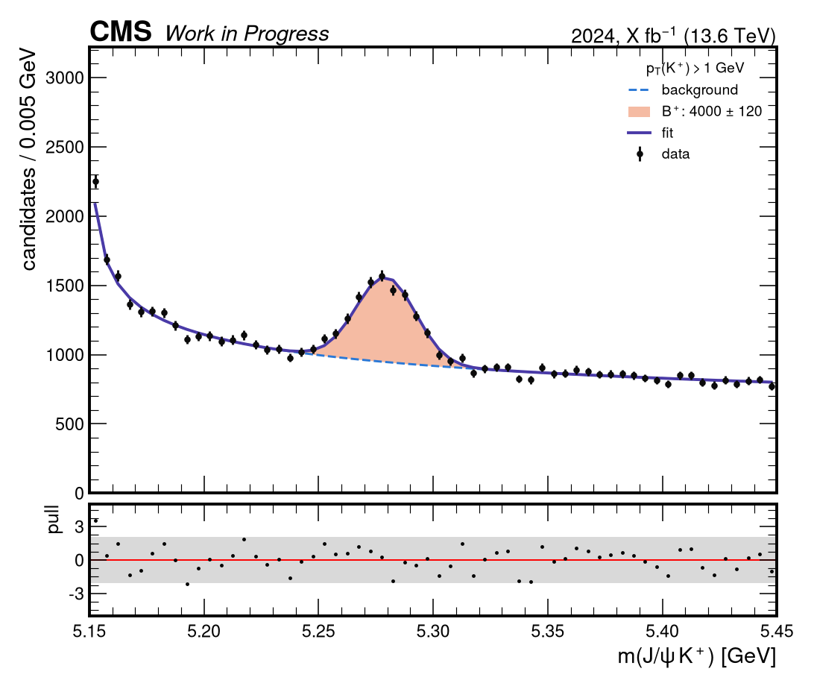
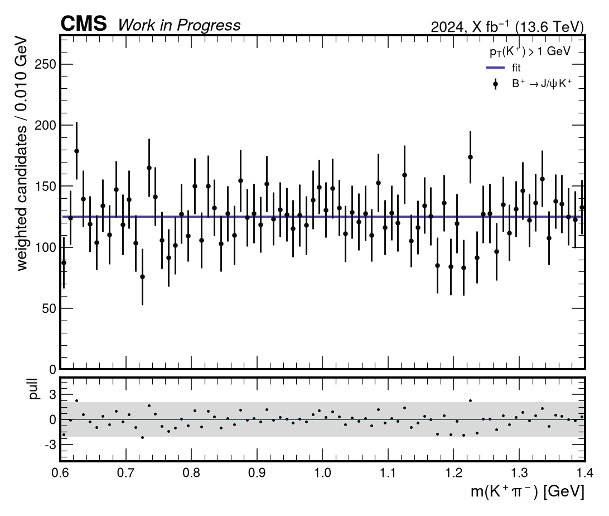
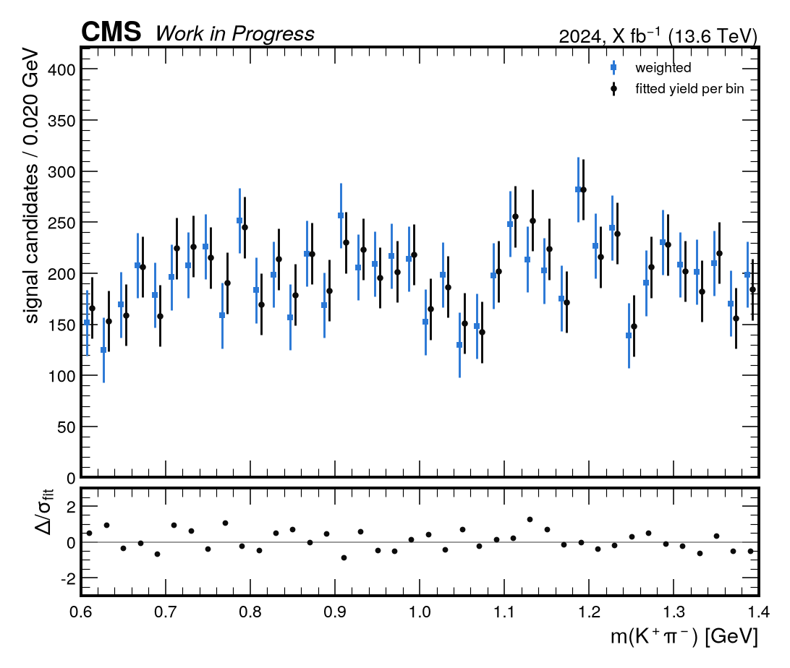
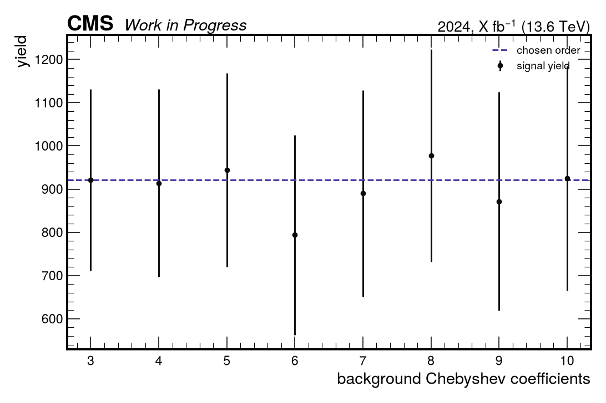
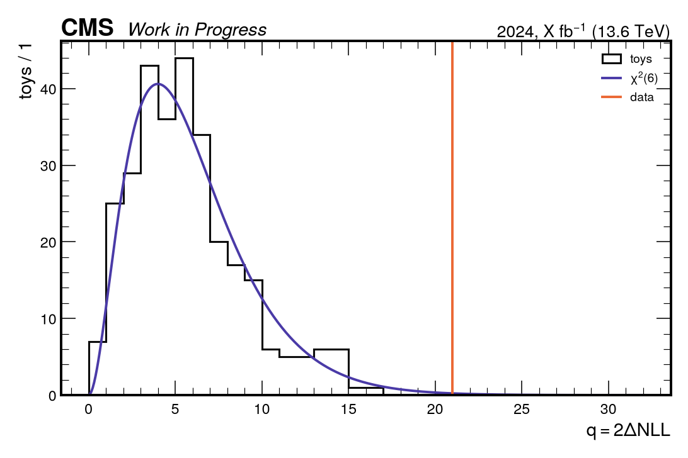
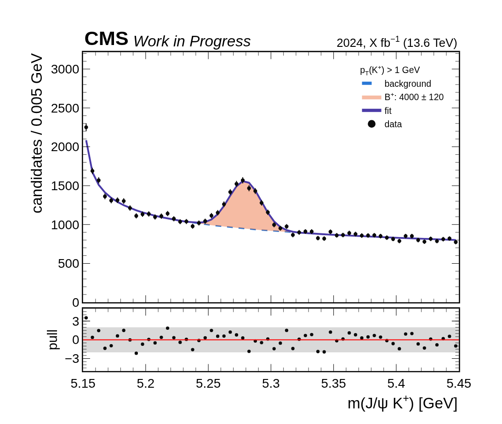
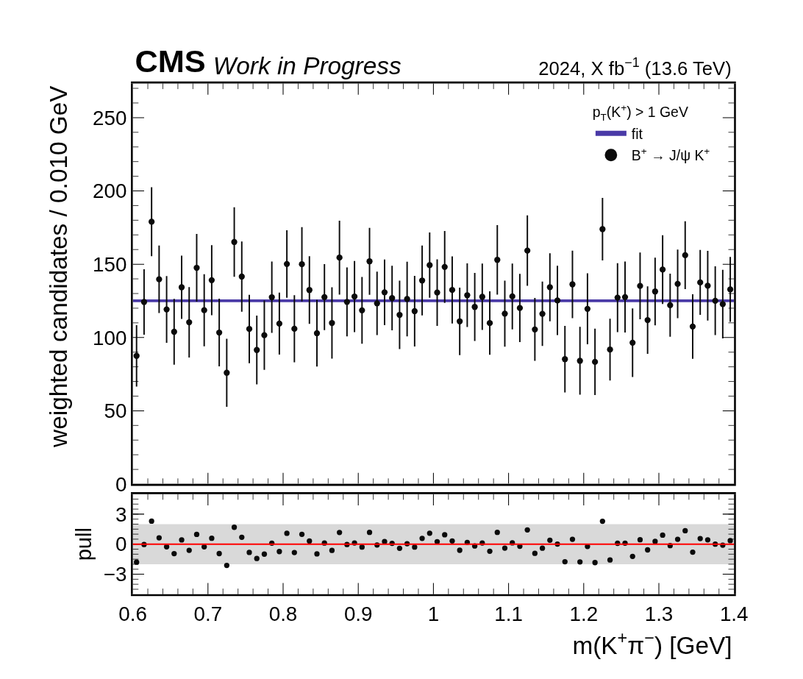
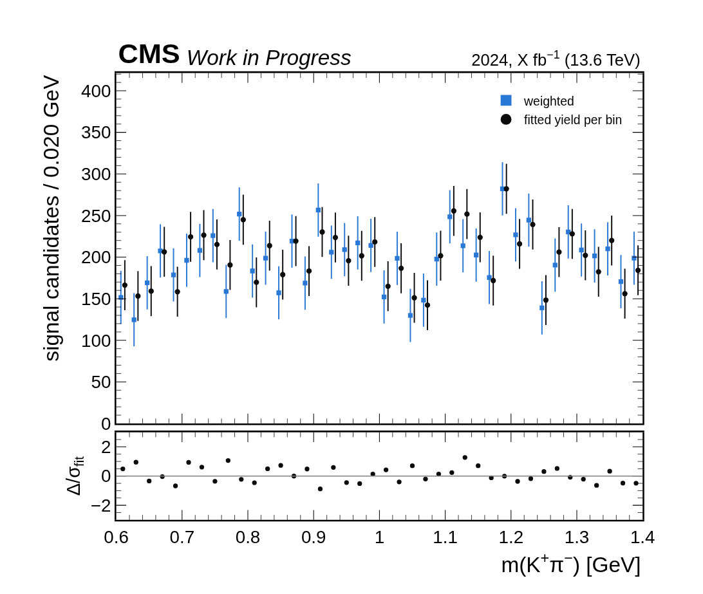
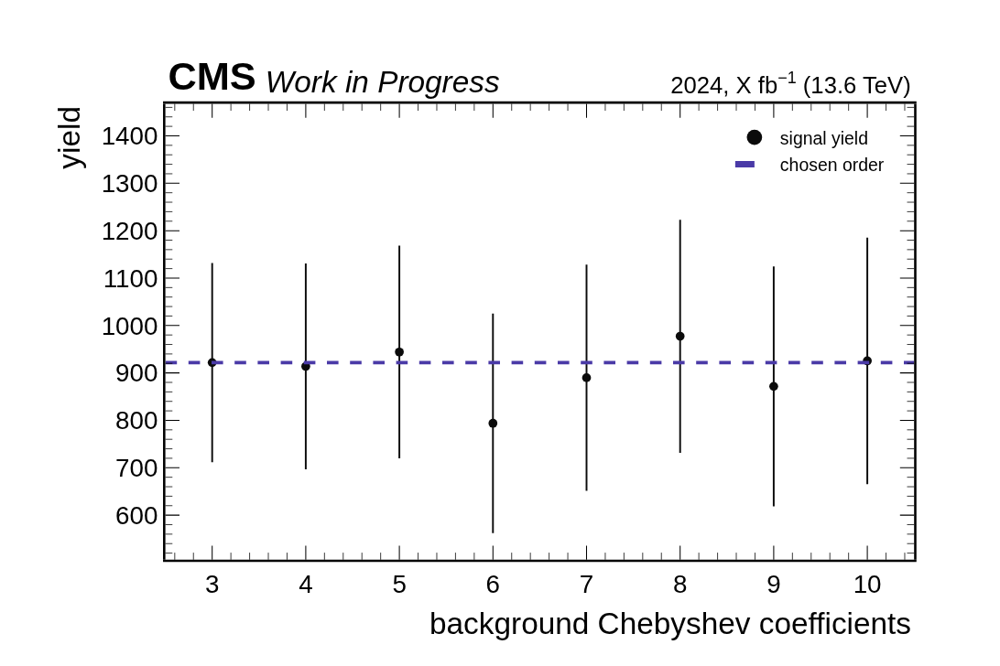
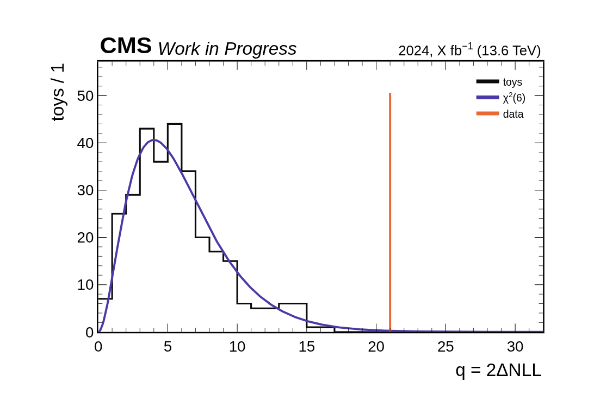

# cms-plotting

A Claude Code skill (and plain Python modules) for CMS-style analysis canvases: mass fits with pull
panels, weighted spectra, method comparisons, stability scans and toy calibrations — plus the rules for
reporting results with them (every number with its fit canvas, no prose on canvases, bin widths in the
axis unit, single-panel files for slides). Two back ends with the same names and palette: `cmsplot.py`
(matplotlib + mplhep) and `cmsplot_plotly.py` (Plotly + [plotlyhep](https://github.com/DickyChant/plotlyhep),
for interactive figures in HTML slides).

| fit | weighted | compare |
|---|---|---|
|  |  |  |
| **scan** | **toys** | |
|  |  | |

The same canvases with `cmsplot_plotly.py`:

| fit | weighted | compare |
|---|---|---|
|  |  |  |
| **scan** | **toys** | |
|  |  | |

All examples are toy inputs with placeholder labels.

## Install in Claude Code

The repository root is the skill. Clone it into a skills folder:

```bash
# for you, in every project
git clone https://github.com/DickyChant/cms-plotting ~/.claude/skills/cms-plotting

# or for one project (commit it, or add it as a submodule)
git clone https://github.com/DickyChant/cms-plotting .claude/skills/cms-plotting
```

Update with `git -C ~/.claude/skills/cms-plotting pull`. The skill loads whenever Claude writes plotting
code or reports fitted numbers.

## Use without Claude

`cmsplot.py` is a standalone module (numpy, matplotlib, optional mplhep). Copy it into
your project:

```python
from cmsplot import fit_figure, cms_label, data_points, draw_pull, bin_label, legend, headroom, save, SERIES

fig, ax, axp = fit_figure()
cms_label(ax, com=13.6, rlabel="2024, X fb$^{-1}$ (13.6 TeV)")
data_points(ax, cen, h)
ax.plot(cen, bkg, "--", color=SERIES["comb"], lw=1.5, label="background")
ax.fill_between(cen, bkg, bkg + sig, color=SERIES["s1"], alpha=0.45, lw=0, label="signal")
ax.plot(cen, bkg + sig, color=SERIES["total"], lw=2, label="fit")
ax.set_ylabel(bin_label(bw)); legend(ax, title="selection"); headroom(ax, h.max())
draw_pull(axp, cen, h, bkg + sig, lo, hi, r"$m(J/\psi\,K^+)$ [GeV]")
save(fig, "plots/fit.png")
```

`python template.py --outdir /tmp/demo` draws all five reference canvases;
`python lint.py my_script.py` checks a script against the rules (matplotlib and Plotly).

### Plotly / plotlyhep

`cmsplot_plotly.py` needs plotly, [plotlyhep](https://github.com/DickyChant/plotlyhep) (not on PyPI) and, for
PNG/PDF, kaleido:

```bash
pip install plotly "kaleido>=1" git+https://github.com/DickyChant/plotlyhep
```

```python
from cmsplot_plotly import fit_figure, cms_label, data_points, line, fill_between, draw_pull
from cmsplot_plotly import bin_label, ylabel, legend, headroom, save, embed, head_script, SERIES

fig, ax, axp = fit_figure()
cms_label(fig, com=13.6, rlabel="2024, X fb<sup>−1</sup> (13.6 TeV)")
line(fig, cen, bkg, SERIES["comb"], "background", dash="dash", width=1.5)
fill_between(fig, cen, bkg, bkg + sig, SERIES["s1"], "signal")
line(fig, cen, bkg + sig, SERIES["total"], "fit")
data_points(fig, cen, h)
ylabel(fig, bin_label(bw)); legend(fig, title="selection"); headroom(fig, h.max())
draw_pull(fig, axp, cen, h, bkg + sig, lo, hi, "m(J/ψ K<sup>+</sup>) [GeV]")
save(fig, "plots/fit.png")                    # plots/fit.json + plots/fit.png
html = head_script() + embed(fig, "fit")      # live figure for an HTML slide
```

`python template_plotly.py --outdir /tmp/demo` draws the five canvases with Plotly.

## Contributing

Open an issue or a pull request. Keep it generic: no analysis results, unpublished luminosities or sample
paths. When the style changes, regenerate `examples/` with `python template.py --outdir examples` and
`python template_plotly.py --outdir examples`.

MIT licensed.
